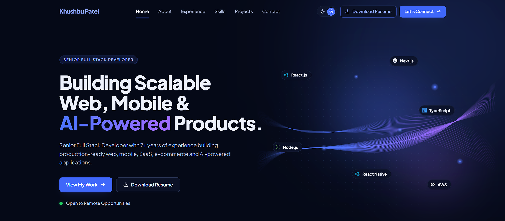

<h1 align="center">Hi 👋, I'm Khushbu Patel</h1>

<h3 align="center">
Senior Full Stack Developer | React.js | Next.js | React Native | Node.js
</h3>

---

# 👩‍💻 About Me

I'm a **Senior Full Stack Developer** with **7+ years of experience** building scalable, secure, and high-performance web and mobile applications.

I specialize in developing enterprise-grade solutions using modern JavaScript technologies, designing scalable architectures, creating REST APIs, and delivering exceptional user experiences.

### What I Do

- ⚛️ Build scalable web applications with React.js & Next.js
- 📱 Develop cross-platform mobile apps using React Native
- 🚀 Build secure REST APIs using Node.js & Express.js
- 🗄 Design scalable databases with MongoDB & PostgreSQL
- 🔐 Implement JWT, OAuth2 & OTP Authentication
- ☁ Deploy applications using Docker, AWS, GitHub Actions & Vercel
- 🧪 Write unit & integration tests
- 👨‍💻 Mentor developers and review code

---

# 🚀 Tech Stack

### Frontend

### Mobile

React Native

### Backend

### Database

### DevOps & Tools

---

# 💼 Professional Experience

- ✅ 8+ Years of Professional Experience
- ✅ Enterprise Web Applications
- ✅ React Native Mobile Applications
- ✅ AI Powered Voice POS Systems
- ✅ REST API Development
- ✅ Authentication & Authorization
- ✅ Performance Optimization
- ✅ CI/CD using GitHub Actions
- ✅ Team Mentoring & Code Reviews

---

# 🌐 Portfolio

---

# 💡 Motto

> **"Building scalable software with clean code, thoughtful architecture, and continuous learning."**
